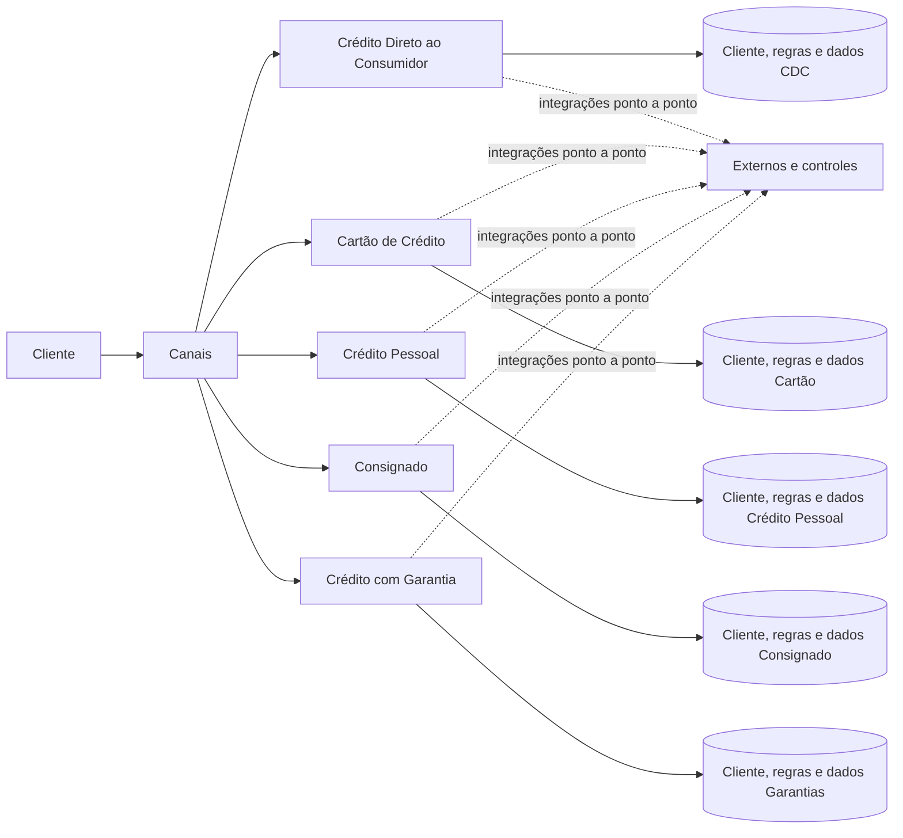
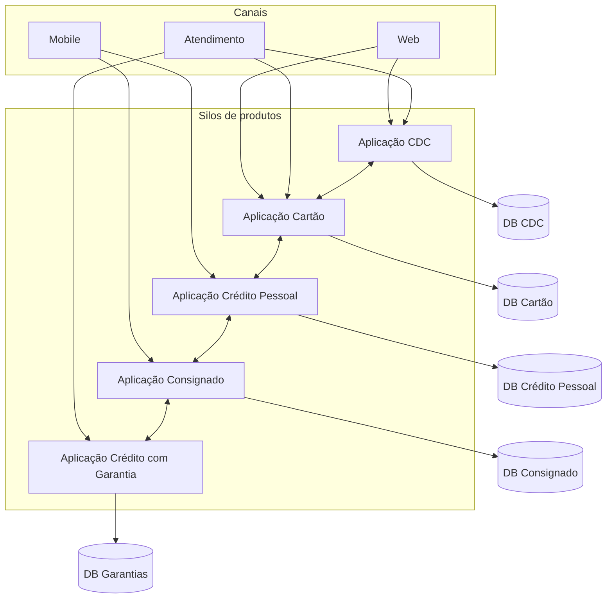
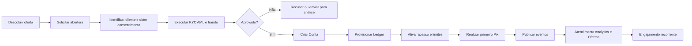
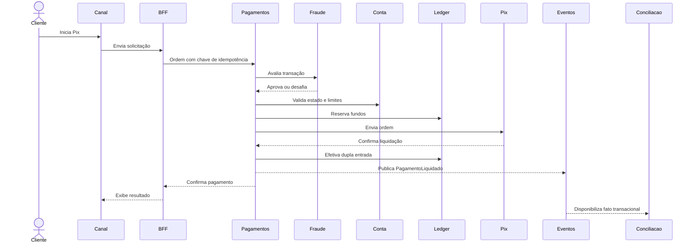
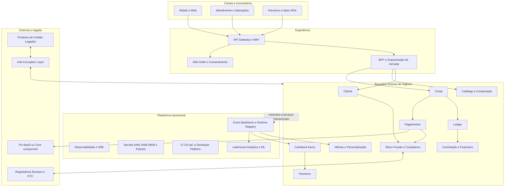

# DAS — Direcional de Arquitetura de Solução

## Título do projeto

**Plataforma de Engajamento Bancário — Conta de Pagamentos**

Implantação de uma Conta de Pagamentos com experiência digital e Pix, apoiada por uma plataforma bancária componível, preservando o estilo de microservices e preparando capacidades reutilizáveis para produtos de crédito, cashback e futuras ofertas.

### Decisão direcional

- priorizar **Conta de Pagamentos**;
- manter **Cashback** como evolução posterior e desacoplada;
- adotar estratégia **buy, build and compose**;
- não aprovar previamente a aquisição integral de Core Bancário;
- modernizar o legado de forma incremental por **Strangler Fig**, APIs, eventos e Anti-Corruption Layer.

---

## Áreas de negócio envolvidas

| Área | Participação e responsabilidade |
|---|---|
| Produtos e Canais Digitais | proposta de valor, jornadas, roadmap e KPIs de engajamento |
| Pagamentos | ciclo da ordem, Pix, limites, devoluções e operação transacional |
| Operações Bancárias | abertura e manutenção de conta, exceções, conciliação e suporte |
| Crédito | integração dos produtos CDC, cartão, crédito pessoal, consignado e garantias |
| Risco e Fraude | políticas, avaliação transacional, bloqueios e gestão de casos |
| Compliance e PLD/FT | KYC, AML, sanções, monitoramento e evidências regulatórias |
| Jurídico e Privacidade | contratos, LGPD, consentimento, finalidade e retenção |
| Financeiro e Contabilidade | lançamentos, conciliação, liquidação e contabilização |
| Atendimento | visão do cliente, consulta de transações e resolução de ocorrências |
| Marketing, CRM e Engajamento | ofertas, personalização, campanhas e futuro cashback |
| Dados e Analytics | produtos de dados, qualidade, lineage, métricas e modelos analíticos |
| Tecnologia e Arquitetura | plataforma, integração, microservices, sourcing e governança |
| Segurança e SRE | IAM, proteção, observabilidade, resiliência e resposta a incidentes |
| Parceiros e Sourcing | BaaS/Core componível, bureaus, KYC e fornecedores estratégicos |

---

## Tamanho do projeto

**Classificação: Grande / Estratégico / Transformacional.**

### Justificativas

- envolve múltiplas unidades de negócio e funções de controle;
- cria capacidades financeiras críticas, incluindo Conta, Ledger e Pagamentos;
- possui impacto regulatório, contábil, operacional e de segurança;
- integra canais, plataformas corporativas, fornecedores e produtos legados;
- requer arquiteturas de transição e coexistência por período prolongado;
- altera o modelo operacional e o ownership de capacidades e dados;
- exige operação de alta disponibilidade e reconciliação financeira;
- habilita novos produtos e reduz progressivamente os silos existentes.

### Horizonte indicativo

| Onda | Horizonte | Resultado principal |
|---|---:|---|
| 0 — Decisão e fundações | 0–3 meses | baseline, modelo regulatório, fit-gap e provas de conceito |
| 1 — Plataforma mínima | 3–6 meses | identidade, cliente, catálogo, APIs, eventos e integração governada |
| 2 — Conta MVP | 6–12 meses | onboarding, conta, ledger, Pix, fraude, conciliação e atendimento |
| 3 — Escala e composição | 12–18 meses | integração com crédito e redução de capacidades duplicadas |
| 4 — Cashback e ecossistema | 18+ meses | fidelidade, parceiros, campanhas, funding e liquidação |

Os prazos são hipóteses de planejamento e dependem do baseline, do modelo regulatório, da capacidade dos times e das decisões de sourcing.

---

## Áreas impactadas

### Impacto alto

- Produtos e Canais Digitais;
- Pagamentos e Operações Bancárias;
- Risco, Fraude, Compliance e PLD/FT;
- Financeiro, Contabilidade e Conciliação;
- Tecnologia, Arquitetura, Segurança, Dados e SRE;
- Atendimento ao cliente.

### Impacto médio

- Crédito e Cartões, pela reutilização progressiva de Cliente, Produto, Risco, Eventos e Pagamentos;
- Marketing e CRM, pelo uso de eventos e personalização;
- Jurídico, Privacidade, Compras e Gestão de Fornecedores;
- Parceiros, bureaus e provedores de BaaS/Core componível.

### Impacto futuro

- Fidelidade e Cashback;
- gestão ampliada de parceiros;
- ecossistema de Open APIs e novas ofertas compostas.

---

## Requisitos de negócios

| ID | Requisito | Classificação | Prioridade | Critério de sucesso |
|---|---|---|---|---|
| BR-01 | aumentar o engajamento dos clientes | Negócio | Must | crescimento de contas ativas e transações por cliente |
| BR-02 | acelerar o lançamento de novos produtos | Negócio | Must | redução do lead time e aumento do reuso |
| BR-03 | priorizar um produto entre Conta e Cashback | Negócio | Must | Conta de Pagamentos aprovada como prioridade |
| BR-04 | reduzir dependência dos silos de produto | Negócio/Arquitetura | Must | capacidades comuns consumidas por mais de um produto |
| FR-01 | realizar onboarding e abertura de conta | Funcional | Must | jornada ponta a ponta aprovada |
| FR-02 | administrar estado, titulares e restrições da conta | Funcional | Must | operações e controles auditáveis |
| FR-03 | manter lançamentos, reservas, saldos e extratos íntegros | Funcional | Must | ledger balanceado e reconciliação aprovada |
| FR-04 | realizar pagamentos Pix, devoluções e consulta de status | Funcional | Must | taxa de sucesso e tratamento de exceções dentro do SLO |
| FR-05 | executar KYC, AML, sanções e avaliação de fraude | Regulatório | Must | controles e evidências aprovados por Risco/Compliance |
| FR-06 | configurar produtos, versões, preços e elegibilidade | Funcional | Must | produto configurável sem criação de novo silo |
| FR-07 | conciliar transações internas e externas | Operacional | Must | divergências identificadas e tratadas |
| FR-08 | fornecer visão integrada ao atendimento | Operacional | Should | consulta de cliente, conta e pagamento por APIs autorizadas |
| FR-09 | publicar eventos para analytics e personalização | Dados | Should | eventos versionados e consumidos com qualidade |
| FR-10 | habilitar cashback desacoplado | Funcional | Could | novo ciclo aprovado após resultados da Conta MVP |
| NFR-01 | preservar microservices organizados por bounded contexts | Arquitetura | Must | serviços com ownership e bancos não compartilhados |
| NFR-02 | garantir segurança, privacidade e auditabilidade | Qualidade/Regulatório | Must | threat model, trilhas e controles aprovados |
| NFR-03 | garantir resiliência e continuidade | Qualidade | Must | SLO, RTO, RPO e testes de recuperação aprovados |
| NFR-04 | garantir idempotência e integridade monetária | Qualidade | Must | ausência de efeito financeiro duplicado |
| NFR-05 | versionar APIs e eventos | Integração | Must | contratos compatíveis e testados |
| TR-01 | coexistir com aplicações legadas | Transição | Must | migração por jornada/coorte sem interrupção crítica |
| TR-02 | evitar lock-in de fornecedor | Sourcing | Should | exportação, portabilidade e exit plan testados |

### Indicadores

- usuários e contas ativas mensalmente;
- transações por cliente por mês;
- produtos ativos por cliente;
- taxa de conclusão e ativação do onboarding;
- lead time para lançamento de produto;
- percentual de capacidades reutilizadas;
- custo por transação e por produto lançado;
- disponibilidade e sucesso das jornadas críticas;
- divergências de conciliação, perdas por fraude e não conformidades.

As metas numéricas devem ser estabelecidas após o levantamento do baseline.

---

## Premissas, riscos e restrições

### Premissas

- a operação está sujeita à regulamentação brasileira e à integração com Pix;
- existem canais digitais, IAM e cadastro de clientes, ainda que fragmentados;
- produtos de crédito possuem aplicações, dados e regras próprios;
- capacidades corporativas aderentes serão reaproveitadas antes de serem substituídas;
- o banco poderá operar diretamente ou contratar parceiro regulado/BaaS;
- contratos de APIs e eventos poderão ser governados corporativamente;
- orçamento, metas, volumes e apetite de risco serão detalhados nas fases de baseline e fit-gap.

### Restrições

- manter microservices como estilo arquitetural predominante;
- não realizar migração big bang;
- não compartilhar bancos de dados entre bounded contexts no estado alvo;
- preservar continuidade operacional e trilhas de auditoria;
- cumprir LGPD, KYC, AML, requisitos de segurança e obrigações regulatórias;
- não selecionar fornecedor antes de fit-gap, TCO, PoC e avaliação de saída;
- o Ledger permanece a fonte autoritativa de lançamentos e saldos monetários.

### Riscos e respostas

| Risco | Impacto | Resposta arquitetural |
|---|---|---|
| Core/BaaS tornar-se novo silo | Alto | arquitetura componível, APIs/eventos, portabilidade e exit test |
| complexidade regulatória atrasar o MVP | Alto | Compliance e Jurídico desde a descoberta; avaliar parceiro regulado |
| inconsistência ou duplicação financeira | Crítico | dupla entrada, idempotência, outbox/inbox e reconciliação |
| falha externa com estado desconhecido | Alto | máquina de estados, consulta, timeout controlado e reconciliação |
| microservices ampliarem complexidade | Alto | decomposição por domínio, ownership, paved roads e SRE |
| migração interromper produtos atuais | Crítico | Strangler, execução paralela, coortes, feature flags e rollback |
| uso inadequado de dados pessoais | Alto | finalidade, consentimento, minimização, retenção e auditoria |
| dependência excessiva de fornecedor | Alto | ports/adapters, cláusulas de saída e exportação periódica testada |
| plataforma excessiva antes de valor | Médio/Alto | thin slices, MVP, KPIs e gates de investimento |
| maturidade operacional insuficiente | Alto | SLOs, runbooks, observabilidade, DR e readiness review |

---

## Fluxo AS-IS

Atualmente, os canais acessam produtos verticais de crédito. Cada produto mantém versões próprias de cadastro, regras, integrações e dados.

### Problemas do fluxo atual

- duplicação e divergência de dados do cliente;
- regras de risco, documentos e controles repetidos;
- dependência dos canais em estruturas internas de cada produto;
- integrações síncronas ponto a ponto e propagação de falhas;
- dificuldade de obter visão integrada e personalizar ofertas;
- alto esforço para lançar ou alterar produtos;
- baixa reutilização das capacidades existentes.

---

## Desenho de solução AS-IS

O desenho é conceitual. O inventário real de aplicações, interfaces, tecnologias, SLAs, custos e consumidores deverá ser confirmado antes da migração.

---

## Fluxo TO-BE

### Fluxo principal — abertura e ativação da Conta de Pagamentos

### Fluxo transacional — Pix

Timeout externo não será interpretado automaticamente como falha. A ordem permanecerá em estado pendente/desconhecido até consulta ou reconciliação, evitando duplicidade por retry.

---

## Desenho de solução TO-BE

### Diretrizes do desenho

- bounded context antes da decomposição física em microservices;
- BFF por experiência, sem concentrar regras de domínio;
- APIs síncronas para comandos e validações imediatas;
- eventos para fatos ocorridos e integração desacoplada;
- database per bounded context;
- transactional outbox/inbox e consumidores idempotentes;
- sagas e compensações explícitas em transações distribuídas;
- ACL para proteger o novo modelo dos legados e fornecedores;
- consumer-driven contract tests e versionamento compatível;
- analytics alimentado por eventos/CDC governado, sem consulta direta às bases operacionais;
- não adotar event sourcing de forma generalizada; o Ledger mantém registros monetários imutáveis.

---

## Descrição dos sistemas impactados

A classificação abaixo combina a visão TO-BE com a arquitetura de aplicações da Fase C. Os nomes representam sistemas, bounded contexts ou capacidades lógicas; a decomposição física e os produtos concretos serão confirmados no desenho detalhado e nas PoCs.

### Canais, experiência e acesso

| Sistema/componente | Situação | Impacto | Responsabilidade e interfaces | Estratégia |
|---|---|---|---|---|
| Mobile e Web | Existente | Alto | jornadas de onboarding, conta, extrato e Pix | reaproveitar e adaptar para BFF/APIs novas |
| Atendimento e Operações | Existente | Alto | visão integrada, consulta de conta/pagamento e tratamento de casos | evoluir telas e remover consultas diretas a silos |
| Portal/Open APIs de Parceiros | Novo/evoluído | Alto | onboarding e integração de parceiros | criar após contratos e segurança definidos |
| API Gateway/WAF | Existente ou plataforma | Alto | autenticação de borda, quotas, proteção, roteamento e analytics | avaliar aderência; evoluir antes de substituir |
| BFF/Orquestração de Jornada | Novo ou evoluído | Alto | adaptar APIs às experiências sem assumir regras dos domínios | implementar por jornada/canal quando necessário |
| IAM/CIAM e Consentimento | Existente | Alto | autenticação, autorização, MFA, consentimento e revogação | reaproveitar com evolução e integração OAuth/OIDC |

### Bounded contexts de negócio

| Sistema/contexto | Situação | Impacto | Responsabilidade | Interfaces principais | Estratégia |
|---|---|---|---|---|---|
| Cliente | Existente fragmentado | Alto | identidade, cadastro comum e relacionamentos | `Customer API`, `ClienteAtualizado` | consolidar ownership e mapear IDs legados |
| Catálogo e Composição | Novo | Alto | produtos, versões, preços e elegibilidade | `Product API`, `ProdutoPublicado` | criar capacidade compartilhável |
| Conta | Novo | Alto | ciclo de vida, titulares, restrições e estado | `Account API`, `ContaAtivada` | criar como bounded context independente |
| Ledger | Novo ou adquirido | Crítico | lançamentos de dupla entrada, reservas e saldos | `Posting API`, `LancamentoEfetivado` | selecionar por PoC entre SaaS e self-hosted |
| Pagamentos | Novo | Crítico | ordem, máquina de estados, devolução e saga | `Payment API`, `PagamentoLiquidado` | criar orquestrador de domínio; integrar Pix por adaptador |
| Risco/Fraude | Existente por silo | Alto | avaliação, decisão, bloqueios e casos | `Risk API`, `TransacaoBloqueada` | reaproveitar regras e compor provedores especializados |
| Compliance KYC/AML | Existente/fornecedor | Alto | identificação, sanções, PLD/FT e evidências | APIs de verificação e eventos de decisão | centralizar orquestração e trilha, sem duplicar por produto |
| Conciliação e Financeiro | Existente fragmentado | Crítico | comparação, divergência, liquidação e contabilização | `Reconciliation API/Event` | evoluir para reconciliação contínua e gestão de casos |
| Ofertas e Personalização | Existente | Médio/Alto | decisão de oferta e personalização | `Offer API`, `OfertaAceita` | reaproveitar, passando a consumir eventos governados |
| Parceiros | Novo/evoluído | Médio | onboarding, contratos, status e SLAs | `Partner API` | implantar por etapas conforme ecossistema |
| Cashback | Futuro | Baixo no MVP | regras, accrual, resgate, funding e settlement | `Rewards API/Event` | fora do MVP; conectar a `PagamentoLiquidado` em novo ciclo |

### Plataformas transversais

| Sistema/componente | Situação | Impacto | Responsabilidade | Estratégia |
|---|---|---|---|---|
| Event Backbone | Existente ou novo | Alto | publicação, consumo, retenção, replay e DLQ | reutilizar padrão corporativo aderente ou selecionar serviço gerenciado |
| Schema Registry | Existente ou novo | Alto | schemas, versões e compatibilidade de eventos | implantar junto à governança de eventos |
| Observabilidade/APM/SRE | Existente | Alto | logs, métricas, traces, SLOs e alertas | evoluir para correlação ponta a ponta e jornadas |
| CI/CD e Developer Platform | Existente | Alto | templates, IaC, artefatos, políticas e paved roads | reaproveitar e incluir controles financeiros/regulatórios |
| Segurança — KMS/HSM/Secrets/SIEM | Existente | Alto | chaves, segredos, detecção e trilha | reaproveitar, validar capacidade e segregação de funções |
| Lakehouse/Analytics/ML | Existente | Médio/Alto | produtos de dados, métricas e personalização | consumir eventos/CDC governado; evitar acesso direto às bases |
| Bancos por contexto | Novo/evoluído | Alto | persistência privada por domínio | selecionar tecnologia por padrão de uso; proibir DB compartilhado |
| Read models/cache/busca | Novo quando necessário | Médio | consultas otimizadas, extrato projetado e idempotência | não utilizar como fonte monetária autoritativa |

### Sistemas legados e externos

| Sistema/componente | Situação | Impacto | Responsabilidade | Estratégia de transição |
|---|---|---|---|---|
| Aplicação CDC | Legado | Médio/Alto | originação e servicing de CDC | encapsular por ACL; reutilizar Cliente/Risco/Eventos progressivamente |
| Aplicação Cartão | Legado | Médio/Alto | cartão, fatura e transações próprias | integrar sem substituir no MVP; mapear capacidades comuns |
| Aplicação Crédito Pessoal | Legado | Médio/Alto | originação e servicing | publicar eventos e migrar capacidades duplicadas por etapas |
| Aplicação Consignado | Legado | Médio | regras e operação de consignação | manter inicialmente; integrar por contratos governados |
| Aplicação Crédito com Garantia | Legado | Médio | originação, garantias e servicing | manter inicialmente; eliminar integrações ponto a ponto |
| Anti-Corruption Layer | Novo | Alto | traduzir modelos, protocolos e IDs legados | construir por fronteira; temporário ou permanente conforme dependência |
| Pix/BaaS/Core componível | Externo a selecionar | Crítico | conectividade Pix e/ou capacidades bancárias especializadas | BaaS no MVP, arquitetura preparada para adaptador multprovedor |
| Bureaus/KYC/Sanções | Externo | Alto | fontes e verificações especializadas | orquestrar múltiplos provedores e manter decisão/trilha no banco |
| Reguladores e arranjos | Externo | Baixo tecnicamente/alto regulatório | regras, reportes e supervisão | manter contratos e formatos; adaptar sistemas internos quando exigido |

### Padrão de migração das aplicações

1. posicionar fachada de APIs e ACL à frente dos legados;
2. mapear consumidores e dependências reais;
3. publicar eventos legados por contratos governados;
4. direcionar novas jornadas aos bounded contexts novos;
5. migrar capacidade por capacidade e por coorte;
6. manter execução paralela e reconciliação quando necessário;
7. testar rollback e continuidade operacional;
8. remover interfaces antigas somente após aceite dos owners e consumidores.

---

## Tabela com itens do SBB

Os SBBs abaixo são alternativas de implementação. A seleção de produtos e fornecedores depende de RFI/RFP, fit-gap, TCO, segurança, requisitos regulatórios e provas de conceito.

### Estratégia global

| Estratégia | Descrição | Avaliação |
|---|---|---|
| S1 — Suíte/Core integral | fornecedor cobre grande parte da solução | avaliar com cautela devido a lock-in e risco de novo silo |
| S2 — Composable/BaaS | componentes especializados integrados por contratos | adequada a capacidades maduras e regulatórias |
| S3 — Build predominante | banco constrói a maior parte da solução | reservar para diferenciação ou gaps de mercado |
| S4 — Híbrida | build no diferencial e buy no commodity | **direção recomendada** |

### Matriz ABB × SBB

| ABB/capacidade | SBB A | SBB B | SBB C | Direção inicial |
|---|---|---|---|---|
| Conta e Ledger | SaaS componível | produto self-hosted | construção própria | PoC entre SaaS e self-hosted; build apenas por gap comprovado |
| Pix | BaaS/participante indireto | conectividade direta | adaptador multiprovedor | BaaS no MVP com arquitetura multi-ready |
| KYC/AML/Fraude | suíte única | orquestração multiprovedor | construção integral | orquestração multiprovedor com regras do banco |
| API Management | plataforma existente | serviço gerenciado | solução self-hosted | avaliar e reutilizar plataforma corporativa aderente |
| Eventos | streaming distribuído | broker de mensageria | serviço gerenciado | usar padrão corporativo aderente; evitar duplicação sem justificativa |
| Dados operacionais | relacional/ledger ACID | key-value/cache | search/read model | tecnologia por padrão de uso e banco por contexto |
| Runtime | containers/Kubernetes | PaaS/serverless | VMs vigentes | paved roads híbridos conforme requisitos |
| Analytics | lakehouse | warehouse | plataforma vigente | reutilizar plataforma aderente com data products |
| Observabilidade | suíte gerenciada | stack corporativa | open source operado | preferir stack corporativa com padrão neutro de telemetria |
| Segurança | IAM/KMS/HSM/SIEM corporativos | serviços gerenciados | componentes especializados | reaproveitar capacidades corporativas após fit-gap |
| Cashback futuro | SaaS de fidelidade | engine extensível | construção própria | decisão em novo ciclo ADM após Conta MVP |

### Critérios de seleção

| Critério | Peso indicativo |
|---|---:|
| aderência funcional | 15% |
| arquitetura, APIs e eventos | 15% |
| segurança e regulação | 15% |
| operação, SLO e recuperação de desastre | 15% |
| dados e portabilidade | 10% |
| TCO de cinco anos | 15% |
| time-to-market | 10% |
| estratégia de saída | 5% |

### Provas de conceito obrigatórias

- configurar produto e abrir conta;
- executar pagamento Pix ponta a ponta;
- simular timeout e estado desconhecido;
- comprovar idempotência em requisições repetidas;
- realizar estorno/devolução e reconciliação;
- processar volume de pico;
- executar recuperação de ambiente e dados;
- exportar e reconstituir o histórico;
- alterar regra sem customizar o núcleo do fornecedor;
- medir esforço operacional, latência, custo e qualidade.

### Desqualificadores

- impossibilidade de exportar dados completos;
- ausência de idempotência e auditoria em fluxos financeiros;
- não atendimento a requisitos regulatórios ou de segurança;
- APIs incompletas que imponham operação manual crítica;
- recuperação de desastre e capacidade não demonstradas;
- contrato sem estratégia de saída aceitável.

---

## Aprovações e próximos passos

1. validar o DAS com Produto, Operações, Risco, Compliance, Segurança, Dados e Arquitetura;
2. confirmar inventário de aplicações, interfaces, owners, SLAs e custos;
3. quantificar NFRs, volumes e metas dos KPIs;
4. concluir o modelo regulatório e operacional da Conta de Pagamentos;
5. executar fit-gap e PoCs dos SBBs críticos;
6. registrar decisões em ADRs e formalizar o Architecture Contract;
7. detalhar a arquitetura da primeira onda e o plano de migração por coorte.

## Documentos de referência

- [Visão de Arquitetura — Plataforma de Engajamento Bancário](visao-arquitetura-banco.md)
- [Fase C2 — Arquitetura de Aplicações](adm/04-fase-c-aplicacoes.md)
- [Alternativas de Solution Building Blocks](adm/12-alternativas-sbb.md)
