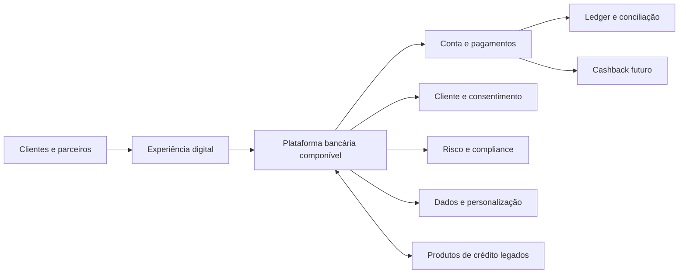

# Resumo Executivo — Plataforma de Engajamento Bancário

## Finalidade

Apresentar ao Comitê Executivo a recomendação da Arquitetura Corporativa para aumentar o engajamento dos clientes, acelerar o lançamento de produtos e reduzir os impactos dos silos tecnológicos existentes.

---

## 1. Decisão recomendada

Recomenda-se **priorizar a Conta de Pagamentos**, com experiência digital e Pix, construída sobre uma **plataforma bancária componível** e integrada progressivamente ao portfólio de crédito atual.

O **Cashback deve ser a evolução seguinte**, implementado como uma capacidade independente de fidelidade e ofertas. Dessa forma, poderá usar os eventos transacionais da conta sem criar dependência entre pagamentos e campanhas promocionais.

### Por que Conta de Pagamentos

- estabelece relacionamento recorrente com o cliente, em vez de interação apenas promocional;
- aumenta a frequência de uso e gera dados transacionais para personalização;
- cria capacidades reutilizáveis de cliente, conta, pagamentos, ledger, limites, compliance e eventos;
- amplia oportunidades de cross-sell com crédito, cartão e demais produtos;
- fornece a base necessária para cashback e futuras ofertas;
- reduz o tempo de lançamento de novos produtos à medida que a plataforma amadurece.

A Conta de Pagamentos demanda maior investimento inicial e maior atenção regulatória que Cashback. Entretanto, possui maior impacto estratégico e maior capacidade de transformar o portfólio e a arquitetura do banco.

---

## 2. Fundamentação da escolha

A avaliação considerou engajamento, capacidade de habilitar novos produtos, dados, prazo, risco, custo e sinergia com o portfólio existente.

| Critério executivo | Conta de Pagamentos | Cashback |
|---|---:|---:|
| Engajamento recorrente | Alto | Médio |
| Fundação para novos produtos | Muito alto | Médio |
| Sinergia com crédito e cartão | Alta | Média |
| Conhecimento do cliente | Alto | Médio |
| Velocidade inicial de lançamento | Média/baixa | Alta |
| Complexidade regulatória | Alta | Média/baixa |
| Investimento inicial | Alto | Médio |
| Valor estratégico de longo prazo | Muito alto | Médio |
| **Pontuação ponderada** | **4,25/5** | **3,20/5** |

A recomendação deverá ser reavaliada caso o banco não disponha de licença ou parceiro regulado viável, capacidade operacional, funding ou apetite de risco compatível. Nessa situação, Cashback poderá ser adotado como iniciativa tática, sem substituir a modernização das capacidades comuns.

---

## 3. Problema estrutural identificado

O desafio do banco não se limita à escolha de um novo produto. Os produtos atuais foram construídos em silos, com duplicação de cadastros, regras, integrações e controles.

### Impactos atuais

- lançamentos lentos e de alto custo;
- visão fragmentada do cliente;
- baixa reutilização entre produtos;
- controles de risco e compliance repetidos ou inconsistentes;
- integrações ponto a ponto difíceis de evoluir;
- aumento do risco operacional;
- dependência de conhecimento e tecnologia específicos de cada silo.

Criar apenas mais um produto sobre esse modelo aumentaria a complexidade. A iniciativa deve, portanto, entregar simultaneamente **valor ao cliente** e **capacidades reutilizáveis para o banco**.

---

## 4. Visão da solução

A proposta preserva o estilo de **microservices**, mas organiza os serviços por capacidades e domínios claros, com proprietários definidos, APIs padronizadas e eventos de negócio.

### Capacidades prioritárias

1. cliente, identidade e consentimento;
2. catálogo e composição de produtos;
3. onboarding, KYC, AML e prevenção a fraudes;
4. conta, ledger, saldo e extrato;
5. pagamentos Pix, limites e devoluções;
6. conciliação, atendimento e operação;
7. APIs, eventos, segurança e observabilidade;
8. dados, analytics, ofertas e personalização;
9. posteriormente, cashback e gestão de parceiros.

---

## 5. Posição sobre aquisição de Core Bancário

Não se recomenda aprovar antecipadamente a aquisição integral de um Core Bancário. **Comprar um core é uma opção de implementação, não uma estratégia de negócio.**

A recomendação é adotar o modelo **buy, build and compose**:

- **comprar** capacidades maduras ou regulatórias quando houver vantagem comprovada, como ledger, conectividade Pix/BaaS, KYC e antifraude;
- **construir** capacidades que diferenciem o banco, como experiência, jornadas, ofertas e composição de produtos;
- **compor** as capacidades por APIs e eventos sob governança do banco.

### Condições para seleção de fornecedores

A decisão deverá ser precedida por fit-gap, prova de conceito e avaliação de:

- aderência funcional e regulatória;
- APIs, eventos e capacidade de integração;
- desempenho, disponibilidade e recuperação de desastre;
- segurança, privacidade e soberania dos dados;
- custo total de propriedade em cinco anos;
- portabilidade integral dos dados;
- risco de dependência do fornecedor;
- estratégia contratual e técnica de saída.

O fornecedor não deve impor um novo monólito nem assumir o controle dos domínios diferenciadores do banco.

---

## 6. Roadmap recomendado

A transformação deve ocorrer de forma incremental, evitando substituição completa do legado em uma única etapa.

| Etapa | Horizonte indicativo | Principais entregas | Valor esperado |
|---|---:|---|---|
| 0. Decisão e fundações | 0–3 meses | baseline, business case, modelo regulatório, arquitetura, fit-gap e PoCs | decisão segura e redução de incertezas |
| 1. Plataforma mínima | 3–6 meses | identidade, cliente, catálogo, APIs, eventos, segurança e integração com legado | visão integrada e menor acoplamento |
| 2. Conta MVP | 6–12 meses | onboarding, conta, ledger, Pix, fraude, conciliação e atendimento | novo produto e engajamento recorrente |
| 3. Escala e composição | 12–18 meses | integração com crédito, automação e migração das capacidades duplicadas | reuso e menor lead time |
| 4. Cashback e ecossistema | 18+ meses | fidelidade, parceiros, campanhas, funding e liquidação | engajamento e monetização adicionais |

Os horizontes são hipóteses de planejamento. Prazos e investimentos devem ser confirmados após o baseline, a definição do modelo regulatório e as provas de conceito.

### Gates executivos

- **Gate 1:** business case, modelo regulatório e estratégia de sourcing aprovados;
- **Gate 2:** segurança, operação, reconciliação e resiliência validadas antes do piloto;
- **Gate 3:** resultados do MVP comprovados antes da expansão;
- **Gate 4:** benefícios e unit economics aprovados antes de Cashback e ecossistema.

---

## 7. Benefícios esperados

### Para clientes

- relacionamento financeiro mais frequente;
- experiência integrada e consistente;
- pagamentos simples e seguros;
- ofertas mais relevantes;
- futura recompensa por uso e relacionamento.

### Para o banco

- aumento de clientes ativos e frequência transacional;
- maior potencial de cross-sell e retenção;
- redução do tempo de lançamento de produtos;
- reutilização de capacidades e controles;
- melhor visão do cliente e qualidade de dados;
- redução progressiva das integrações ponto a ponto;
- maior capacidade de conectar parceiros e criar ecossistemas.

### Indicadores propostos

- usuários e contas ativas mensalmente;
- transações por cliente por mês;
- produtos ativos por cliente;
- taxa de ativação da conta;
- lead time para lançamento de produto;
- percentual de capacidades reutilizadas;
- custo por transação e por produto lançado;
- disponibilidade e taxa de sucesso das jornadas;
- perdas por fraude e ocorrências de não conformidade.

As metas quantitativas devem ser definidas após o levantamento do baseline atual.

---

## 8. Principais riscos e respostas

| Risco | Resposta proposta |
|---|---|
| Core ou fornecedor tornar-se um novo silo | arquitetura componível, contratos abertos, portabilidade e testes de saída |
| Complexidade regulatória atrasar a iniciativa | envolver Risco, Compliance e Jurídico desde a concepção; avaliar parceiro regulado |
| Inconsistência financeira | ledger de dupla entrada, idempotência, auditoria e conciliação contínua |
| Interrupção causada pela migração | migração incremental, execução paralela, reconciliação e rollback |
| Microservices aumentarem a complexidade | decomposição por domínios, ownership claro e plataforma padronizada |
| Investimento em tecnologia sem valor comprovado | entregas em fatias, KPIs por etapa e gates de continuidade |
| Uso inadequado de dados pessoais | consentimento, finalidade, minimização, retenção e auditoria |
| Dependência excessiva de fornecedor | estratégia multicomponente, cláusulas de saída e exportação periódica de dados |

---

## 9. Governança proposta

A iniciativa deve ser conduzida como transformação de negócio, e não apenas como projeto de tecnologia.

- patrocínio executivo conjunto de Negócio e Tecnologia;
- participação permanente de Risco, Compliance, Segurança, Jurídico e Operações;
- Architecture Board para decisões estruturantes e conformidade;
- responsáveis de negócio e tecnologia para cada capacidade;
- financiamento incremental condicionado a resultados;
- acompanhamento por KPIs de negócio, operação, risco e arquitetura;
- decisões relevantes registradas e rastreáveis.

Cada capacidade somente será considerada concluída quando possuir responsável, controles, métricas, operação, suporte, segurança e evidência de valor.

---

## 10. Deliberações solicitadas ao Comitê Executivo

1. **Aprovar a Conta de Pagamentos como produto prioritário**, mantendo Cashback como evolução planejada.
2. **Aprovar a direção de arquitetura componível**, preservando microservices e evitando a criação de um novo silo.
3. **Autorizar a etapa inicial de 0–3 meses** para baseline, business case detalhado, modelo regulatório, fit-gap e provas de conceito.
4. **Aprovar o princípio buy, build and compose**, sem compromisso antecipado com a aquisição integral de um Core Bancário.
5. **Definir patrocinadores executivos** de Negócio e Tecnologia e instituir a governança multidisciplinar.
6. **Condicionar as ondas seguintes aos gates executivos**, aos resultados do MVP e aos indicadores de risco e valor.

---

## Recomendação final

A Conta de Pagamentos representa a alternativa com maior potencial para transformar engajamento, relacionamento e capacidade de inovação. Seu valor, contudo, depende de ser implementada como parte de uma plataforma reutilizável e não como mais um produto isolado.

A abordagem proposta equilibra ambição e controle de risco: valida as decisões de sourcing antes de comprometer capital relevante, entrega valor em etapas e moderniza o legado progressivamente. Cashback permanece no roadmap como mecanismo adicional de engajamento, apoiado pela base transacional e pelas capacidades criadas na primeira fase.

> **Decisão proposta ao Comitê:** avançar com a Conta de Pagamentos e autorizar a fase inicial de validação e fundações, sem aprovar neste momento a aquisição integral de um Core Bancário.

---

**Documento de referência:** [Visão de Arquitetura — Plataforma de Engajamento Bancário](visao-arquitetura-banco.md)
