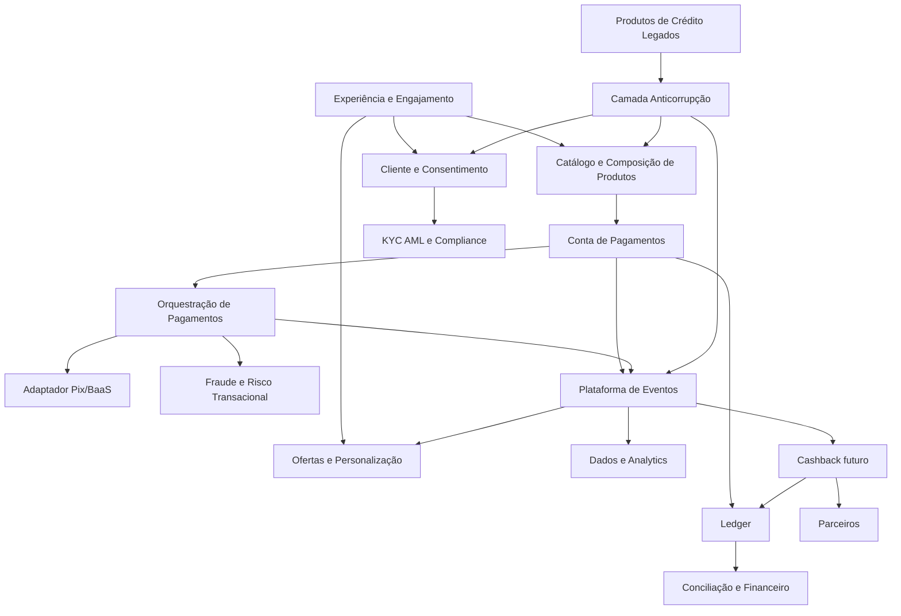
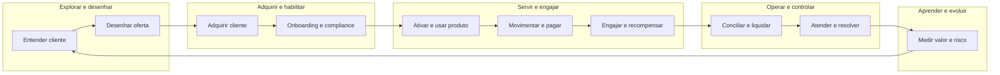
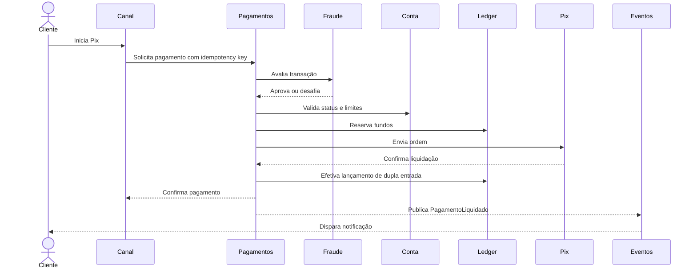
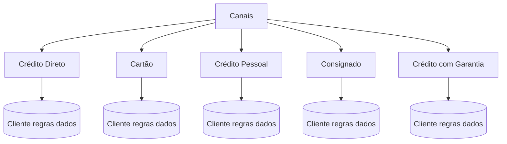
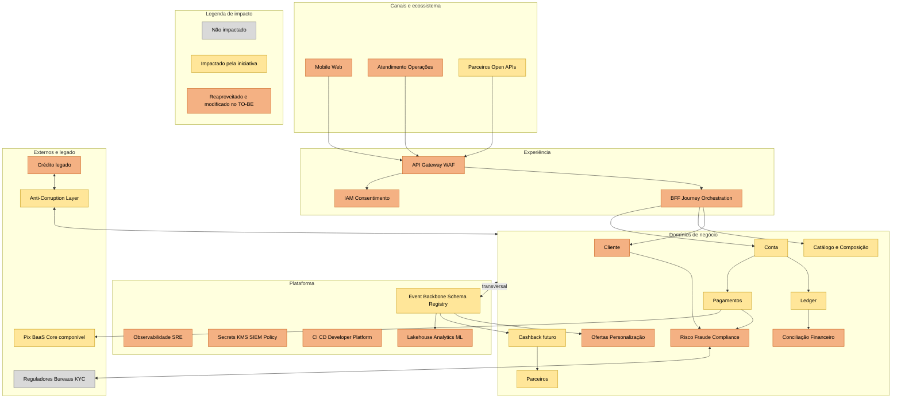
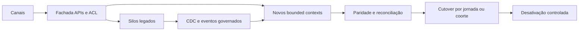

# Visão de Arquitetura — Plataforma de Engajamento Bancário

## 1. Resumo executivo

### Decisão recomendada

**Priorizar a Conta de Pagamentos**, construída sobre uma **plataforma bancária componível**, preservando o estilo de microservices e preparando capacidades reutilizáveis para cashback e outros produtos.

A Conta de Pagamentos é recomendada porque:

1. cria um relacionamento financeiro recorrente, e não apenas promocional;
2. gera eventos transacionais que permitem personalização e cashback futuro;
3. força a criação das capacidades estruturantes hoje ausentes: cliente, conta, ledger, pagamentos, limites, compliance e eventos;
4. amplia a velocidade de lançamento de produtos por meio de building blocks reutilizáveis;
5. reduz a dependência dos silos de crédito existentes;
6. oferece maior potencial estratégico, embora possua maior custo e risco regulatório que cashback.

**Cashback deve ser a próxima evolução**, implementado como capacidade desacoplada de fidelidade e ofertas, consumindo eventos da Conta de Pagamentos. Para reduzir risco e antecipar valor, recomenda-se entregar primeiro uma conta mínima, com Pix e experiência digital, e depois habilitar cashback por parceiros.

### Posição sobre aquisição de Core Bancário

Não se recomenda decidir pela aquisição de um Core Bancário antes de um **fit-gap orientado a capacidades**. “Comprar um core” é uma alternativa de implementação, não a arquitetura de negócio.

A recomendação é um processo **buy, build and compose**:

- **comprar** capacidades comoditizadas e regulatórias quando houver aderência comprovada, como ledger certificado, Pix/BaaS, KYC ou prevenção a fraudes;
- **construir** capacidades diferenciadoras, como experiência, jornadas, ofertas e orquestração de produtos;
- **compor** tudo por contratos de API e eventos sob governança da plataforma bancária.

O fornecedor não deve impor um monólito funcional nem substituir os bounded contexts do banco. A decisão de compra deve considerar aderência funcional, APIs, eventos, portabilidade de dados, operação, soberania, segurança, custo total, SLA e estratégia de saída.

---

## 2. Escopo, premissas e resultados esperados

### Escopo

- visão de arquitetura para aumentar engajamento e portfólio;
- comparação entre Conta de Pagamentos e Cashback;
- evolução dos silos legados para capacidades compartilhadas;
- preservação de microservices como estilo arquitetural;
- definição de arquitetura alvo, transições e roadmap.

### Premissas a validar na Fase A do ADM

- atuação sujeita à regulamentação brasileira e integração com Pix;
- existência de canais digitais e cadastro de clientes, ainda que fragmentados;
- produtos de crédito possuem sistemas e dados próprios;
- o banco pode atuar diretamente ou usar parceiros regulados/BaaS;
- metas quantitativas, orçamento, prazo e apetite de risco ainda serão definidos.

### KPIs propostos

| Objetivo | Indicador | Direção/hipótese inicial |
|---|---|---|
| Engajamento | usuários ativos mensais/contas ativas | aumentar |
| Recorrência | transações por cliente/mês | aumentar |
| Relacionamento | produtos ativos por cliente | aumentar |
| Velocidade | lead time de lançamento | reduzir em pelo menos 50% após consolidação da plataforma |
| Reuso | percentual de capacidades compartilhadas por produto | aumentar |
| Eficiência | custo por transação e por produto lançado | reduzir |
| Resiliência | disponibilidade e taxa de falha das jornadas críticas | melhorar |
| Risco | perdas por fraude e não conformidades | manter dentro do apetite aprovado |

Os valores-alvo devem ser baselined nas Fases A e B; não há dados suficientes para fixar números além das hipóteses.

---

## 3. Aplicação do TOGAF ADM

Esta iniciativa usa o ADM de modo iterativo e orientado a valor, evitando documentação sem finalidade decisória.

| Fase | Aplicação no caso | Entregáveis/decisões |
|---|---|---|
| Preliminar | princípios, governança, metamodelo, repositório e papéis | princípios arquiteturais, Architecture Board, critérios de conformidade |
| A — Visão | problema, stakeholders, escopo, valor, riscos e opção de produto | este documento, business case inicial, Statement of Architecture Work |
| B — Negócio | capacidades, domínios, value streams e organização | capability map, domain map, gaps e arquitetura de negócio alvo |
| C — Sistemas de Informação | aplicações, dados, APIs e eventos | arquitetura de dados/aplicações, contratos e ownership |
| D — Tecnologia | runtime, cloud/on-premises, segurança, observabilidade | plataforma tecnológica e NFRs |
| E — Oportunidades e Soluções | agrupar work packages e avaliar compra/construção | fit-gap do core, solution building blocks e arquiteturas de transição |
| F — Migração | dependências, custos, benefícios e priorização | roadmap, ondas, plano de migração e benefícios |
| G — Governança | contratos, checkpoints e conformidade | Architecture Contract, quality gates, ADRs e métricas |
| H — Mudança | observar valor, dívida e mudanças regulatórias | backlog arquitetural e novos ciclos ADM |
| Gestão de Requisitos | rastreabilidade contínua | catálogo requisito → capacidade → building block → entrega → KPI |

### Guias e abordagens complementares

- **DDD estratégico:** delimita subdomínios e ownership, reduzindo acoplamento semântico entre silos.
- **Capability-Based Planning:** prioriza o que o banco precisa saber fazer, independentemente de organograma ou fornecedor.
- **Value Stream Mapping:** liga capacidades a valor mensurável para cliente e banco.
- **Strangler Fig:** permite migração incremental, sem substituição big bang.
- **Team Topologies:** alinha times aos fluxos e bounded contexts, com times de plataforma e enabling teams.
- **Event Storming:** descobre eventos, regras, comandos e exceções com negócio, risco e tecnologia.
- **Wardley/fit-gap e TCO:** apoiam escolhas buy/build/compose conforme diferenciação e maturidade de mercado.

---

## 4. Stakeholders e preocupações

| Stakeholder | Preocupações | Evidência/artefato |
|---|---|---|
| C-level | engajamento, receita, time-to-market | business case, KPIs, roadmap |
| CTO | modernização e alternativa de core | fit-gap, arquitetura alvo, TCO e exit plan |
| CIO | alinhamento corporativo e governança | capability map, princípios e roadmap |
| Produtos | jornadas, autonomia e experimentação | value streams e APIs de produto |
| Operações | conciliação, exceções e atendimento | processos operacionais e observabilidade |
| Risco/Compliance/Legal | KYC, AML, privacidade, fraude e auditoria | controles by design e trilhas imutáveis |
| Segurança | identidade, proteção de dados e resiliência | threat modeling, IAM, criptografia e SRE |
| Arquitetura | reuso, desacoplamento e conformidade | building blocks, padrões e ADRs |
| Clientes/Parceiros | simplicidade, confiança e integração | jornadas, SLAs e portal de parceiros |

---

## 5. Mapa de problemas e subdomínios

### Problemas de negócio

| Problema | Causa observada/inferida | Impacto na cadeia de valor | Subdomínios afetados |
|---|---|---|---|
| Baixo engajamento | portfólio centrado em crédito e interações episódicas | baixa frequência e pouco conhecimento comportamental | Engajamento, Conta, Pagamentos |
| Lançamentos lentos | capacidades duplicadas nos produtos | alto lead time, custo e risco | Produto, Cliente, Risco, Operações |
| Visão fragmentada do cliente | dados e regras pertencem aos silos | personalização limitada e atendimento inconsistente | Cliente, Dados, Consentimento |
| Integrações ponto a ponto | ausência de contratos canônicos e eventos governados | propagação de falhas e mudança cara | Integração, Plataforma |
| Controles repetidos | KYC, fraude, limites e documentos por produto | custo operacional e inconsistência | Compliance, Risco, Segurança |
| Baixo reuso | equipes orientadas a sistemas/produtos legados | duplicação e dependências organizacionais | Todos |
| Risco de lock-in | core tratado como solução total | menor autonomia e alto custo de saída | Arquitetura, Sourcing |

### Classificação DDD dos subdomínios

| Tipo | Subdomínios | Diretriz |
|---|---|---|
| **Core/diferenciador** | Experiência e Engajamento; Composição de Produtos; Ofertas e Personalização; Ecossistema de Parceiros | manter domínio e evolução sob liderança do banco |
| **Supporting** | Conta de Pagamentos; Orquestração de Pagamentos; Limites; Tarifas; Conciliação; Atendimento; Cashback futuro | construir ou compor conforme diferencial e maturidade |
| **Generic** | KYC/KYB; AML; IAM; notificações; assinatura; observabilidade; infraestrutura | preferir componentes maduros/serviços, com integração desacoplada |

> O ledger é estratégico pela criticidade, mas sua mecânica é amplamente padronizada. O banco deve manter domínio sobre contratos, dados, reconciliação e operação, mesmo quando adquirir a tecnologia.

### Context map proposto

**Relações DDD:** APIs síncronas para validações imediatas; eventos para propagação de fatos; camada anticorrupção para modelos legados e de fornecedores; Open Host Service para parceiros; Published Language versionada para APIs e eventos.

---

## 6. Mapa de capacidades de negócio

Classificação: **Estratégica** (diferenciação), **Core operacional** (necessária à operação), **Suporte** (habilitadora). Maturidade inferida: 1 inicial, 2 fragmentada, 3 definida, 4 gerenciada, 5 otimizada.

| L1 | Capacidades L2 relevantes | Classe | Maturidade AS-IS | Alvo | Gap/prioridade |
|---|---|---:|---:|---:|---|
| Gestão de Clientes | identidade, cadastro mestre, consentimento, preferências, visão 360 | Estratégica | 2 | 4 | crítico |
| Gestão de Produtos | catálogo, elegibilidade, configuração, pricing, ciclo de vida | Estratégica | 1–2 | 4 | crítico |
| Engajamento | jornada omnicanal, campanhas, personalização, ofertas | Estratégica | 2 | 4 | alto |
| Conta de Pagamentos | abertura, manutenção, saldo, extrato, bloqueio/encerramento | Core | 1 | 4 | crítico |
| Movimentação Financeira | ledger de dupla entrada, reservas, lançamentos e estornos | Core | 1–2/silos | 5 | crítico |
| Pagamentos | iniciação, Pix, agendamento, devolução, status e exceções | Core | 1–2 | 4 | crítico |
| Risco e Compliance | KYC, AML, fraude, sanções, monitoramento e casos | Core | 2/silos | 4 | crítico |
| Fidelidade e Cashback | regras, accrual, resgate, funding e settlement | Estratégica | 1 | 3 | posterior |
| Parceiros | onboarding, contratos, APIs, comissionamento e SLA | Estratégica | 1 | 4 | alto |
| Operações | conciliação, liquidação, disputas e atendimento | Core | 2/silos | 4 | crítico |
| Dados e Inteligência | eventos, qualidade, lineage, analytics, ML | Estratégica | 2 | 4 | alto |
| Plataforma Digital | API management, eventos, DevSecOps, observabilidade, IAM | Suporte | 2–3 | 4 | crítico |
| Crédito | originação, decisão, contratação, servicing e cobrança | Core existente | 2–3/silos | 4 | modernizar incrementalmente |

### Heatmap de investimento

- **Potencializar:** microservices já aderentes, CI/CD, canais digitais e integrações Pix existentes, após avaliação de conformidade.
- **Remediar:** cliente, produto, IAM, eventos, observabilidade, conciliação e controles compartilhados.
- **Criar:** conta, ledger compartilhável, composição de produtos, ecossistema de parceiros e fidelidade.
- **Encapsular/migrar:** cadastros, regras e integrações duplicados nos silos de crédito.
- **Descontinuar:** integrações ponto a ponto e cópias de capacidades sem owner claro, somente após migração e reconciliação.

---

## 7. Value chain, value streams e interoperabilidade

### Cadeia de valor com agrupamentos funcionais

Capacidades transversais: segurança, risco, compliance, dados, plataforma, finanças, pessoas e governança.

### Value stream 1 — Adquirir e ativar uma Conta de Pagamentos

| Estágio | Valor entregue | Capacidades | Sistemas/contextos |
|---|---|---|---|
| Descobrir | oferta relevante | Engajamento, Produto, Analytics | Experiência, Catálogo, Ofertas |
| Solicitar | jornada simples | Canais, Cliente, Documentos | Experience API, Cliente |
| Verificar | confiança e conformidade | KYC, AML, Fraude, Consentimento | Compliance e provedores |
| Decidir | resposta rápida e explicável | Elegibilidade, Risco | Produto, Regras |
| Provisionar | conta pronta e segura | Conta, Ledger, IAM | Conta, Ledger, Identidade |
| Ativar | primeiro uso | Pagamentos, Notificações | Pagamentos, Pix, Comunicação |
| Engajar | recorrência e relevância | Personalização, Dados, Ofertas | Eventos, Analytics, Ofertas |

### Value stream 2 — Realizar pagamento Pix

Exceções obrigatórias: timeout, resposta desconhecida, duplicidade, devolução, estorno compensatório, análise manual e reconciliação. O ledger não é atualizado por consumidores externos: somente seu bounded context registra lançamentos.

### Value stream futuro — Recompensar com cashback

`PagamentoLiquidado` → verificar elegibilidade → calcular recompensa → reservar funding do parceiro → creditar cashback no ledger → notificar cliente → liquidar com parceiro → medir campanha.

Esse fluxo demonstra por que a Conta de Pagamentos é uma fundação para cashback, sem acoplar o pagamento à campanha.

---

## 8. Requisitos e rastreabilidade

### Classificação

| ID | Requisito | Tipo | Prioridade | Capacidade | Building block | KPI/aceite |
|---|---|---|---|---|---|---|
| BR-01 | aumentar engajamento | Negócio | Must | Engajamento, Conta | Ofertas, Conta, Eventos | MAU, frequência transacional |
| BR-02 | acelerar novos produtos | Negócio | Must | Produto, Plataforma | Catálogo, APIs, eventos, templates | lead time e reuso |
| BR-03 | priorizar um produto | Negócio | Must | Portfólio | decision matrix | decisão aprovada |
| AR-01 | preservar microservices | Arquitetura | Must | Plataforma | runtime, API gateway, event backbone | conformidade arquitetural |
| AR-02 | reduzir silos | Arquitetura | Must | Cliente, Produto, Risco | serviços compartilháveis e ACL | menos duplicações/ponto a ponto |
| FR-01 | abrir e manter conta | Funcional | Must | Conta | Account Service | jornada E2E aprovada |
| FR-02 | manter saldo e extrato íntegros | Funcional | Must | Ledger | Ledger Service | reconciliação e invariantes |
| FR-03 | movimentar via Pix | Funcional | Must | Pagamentos | Payment Orchestrator, Pix Adapter | taxa de sucesso/SLA |
| FR-04 | executar KYC/AML e fraude | Funcional/Regulatório | Must | Compliance | Compliance Services | controles e auditoria |
| FR-05 | configurar produtos sem novo silo | Funcional | Must | Produto | Product Catalog/Composer | lançamento configurável |
| NFR-01 | garantir segurança e privacidade | Qualidade/Regulatório | Must | Segurança | IAM, KMS, SIEM, consentimento | testes e controles aprovados |
| NFR-02 | resiliência e continuidade | Qualidade | Must | Plataforma | multi-AZ, DR, SRE | SLO/RTO/RPO aprovados |
| NFR-03 | auditabilidade ponta a ponta | Qualidade | Must | Dados/Compliance | logs imutáveis, tracing, lineage | trilha reproduzível |
| NFR-04 | interoperabilidade versionada | Qualidade | Must | Integração | API/event standards | contratos e compatibilidade |
| TR-01 | coexistir com legados | Transição | Must | Integração | ACL, CDC, strangler | migração sem interrupção |
| TR-02 | evitar lock-in de core | Transição | Should | Sourcing/Plataforma | ports/adapters, exportação | exit test e dados portáveis |
| FR-06 | habilitar cashback | Funcional | Could/fase posterior | Fidelidade | Rewards Service | adesão e uso após MVP |

### Funcionalidades emergentes

- onboarding digital, identidade e consentimento;
- abertura, bloqueio, desbloqueio e encerramento de conta;
- saldo disponível/contábil, extrato, reservas, lançamentos e estornos;
- Pix, agendamento, devolução, limites e gestão de favorecidos;
- KYC, AML, sanções, fraude, casos e revisão manual;
- catálogo, composição, elegibilidade, tarifas e versionamento de produto;
- notificações e atendimento com visão 360;
- conciliação, liquidação, contabilização e relatórios regulatórios;
- portal/API de parceiros;
- telemetria de produto e experimentação;
- posteriormente, campanhas, regras, funding, accrual e resgate de cashback.

---

## 9. Decisão entre Conta de Pagamentos e Cashback

Pontuação: 1 (desfavorável) a 5 (favorável). Pesos devem ser confirmados pelo Architecture Board e patrocinadores.

| Critério | Peso | Conta | Cashback | Fundamentação |
|---|---:|---:|---:|---|
| Engajamento recorrente | 20% | 5 | 3 | conta participa da rotina financeira; cashback depende de campanhas/parceiros |
| Fundação para novos produtos | 20% | 5 | 3 | conta, ledger, pagamentos e eventos têm amplo reuso |
| Dados e visão do cliente | 10% | 5 | 3 | eventos transacionais enriquecem conhecimento e personalização |
| Time-to-market | 10% | 2 | 4 | cashback tende a ser mais rápido |
| Complexidade regulatória/risco | 10% | 2 | 4 | conta exige controles e operação mais robustos |
| Sinergia com portfólio | 10% | 5 | 3 | conta habilita desembolso, cobrança e cross-sell de crédito |
| Receita/valor de longo prazo | 10% | 5 | 3 | maior relacionamento e opções de monetização |
| Custo inicial | 5% | 2 | 4 | conta requer plataforma e operação mais amplas |
| Independência de parceiros | 5% | 4 | 2 | cashback é sensível à rede, funding e settlement de parceiros |
| **Resultado ponderado** | **100%** | **4,25** | **3,20** | recomenda-se Conta de Pagamentos |

### Guardrail da decisão

A decisão deve ser revista se o banco não tiver licença/parceiro regulado viável, funding, capacidade operacional ou apetite de risco. Nesse caso, cashback pode ser um **MVP tático**, mas não deve substituir a modernização das capacidades comuns.

---

## 10. Princípios e padrões arquiteturais

1. **Capacidade antes de sistema:** cada investimento deve fechar um gap de capacidade mensurável.
2. **Bounded context antes de microservice:** a fronteira de negócio precede a unidade de deploy.
3. **Dono único de dados e regras:** nenhuma tabela compartilhada entre contextos.
4. **API-first e event-driven:** comandos/consultas explícitos; fatos publicados como eventos imutáveis.
5. **Ledger como fonte monetária:** saldos derivados de lançamentos de dupla entrada, não alterados diretamente.
6. **Segurança, privacidade e compliance by design.**
7. **Automação e observabilidade por padrão:** CI/CD, policy as code, métricas, logs e traces.
8. **Evolução incremental:** strangler, coexistência e rollback; sem big bang.
9. **Portabilidade:** contratos e dados exportáveis, inclusive para componentes adquiridos.
10. **Reuso com baixo acoplamento:** compartilhar capacidades, não bancos de dados nem bibliotecas de domínio indiscriminadas.

### Padrões de decomposição de microservices

- por bounded context e capacidade de negócio;
- por agregado quando houver independência transacional e operacional real;
- database per service/context;
- saga/orquestração para transações distribuídas; compensações explícitas;
- transactional outbox/inbox, idempotência e deduplicação;
- CQRS somente quando os modelos de leitura e escrita justificarem a complexidade;
- API Gateway/BFF para canais, sem lógica de domínio no gateway;
- anti-corruption layer para legados e fornecedores;
- consumer-driven contracts e schema registry;
- bulkheads, timeout, retry com backoff e circuit breaker;
- evitar microservices excessivamente pequenos, chatty e organizados por entidade técnica.

### Estilos impactados pela Visão

O estilo principal continua sendo **microservices**, complementado por:

- **event-driven architecture** para desacoplamento e dados em tempo quase real;
- **hexagonal architecture** internamente, isolando domínio de fornecedor e infraestrutura;
- **layered security/zero trust** para acesso e segmentação;
- **data products** para consumo analítico governado, sem usar o lake como integração operacional.

Não se recomenda event sourcing generalizado. O ledger deve preservar lançamentos imutáveis; outros contextos podem usar persistência convencional e eventos de integração.

---

## 11. Arquitetura AS-IS e TO-BE

### AS-IS conceitual

Consequências: duplicação, divergência semântica, alto custo de mudança, controles inconsistentes e impossibilidade de compor produtos rapidamente.

### TO-BE conceitual

#### Critério de classificação do impacto

- **Cinza — não impactado:** elemento mantido sem alteração arquitetural; apenas seu contrato de integração será respeitado.
- **Amarelo — impactado:** capacidade nova ou elemento diretamente introduzido ou afetado pela iniciativa da Conta de Pagamentos.
- **Laranja — reaproveitado e modificado:** capacidade ou ativo existente que será preservado, adaptado e integrado à arquitetura TO-BE.

A classificação é uma hipótese de Visão de Arquitetura e deve ser confirmada pelo inventário da Fase B/C do TOGAF. Em especial, componentes de plataforma marcados em laranja serão evoluídos, e não substituídos automaticamente.

### Dados e governança

- Cliente, Conta, Produto, Pagamento e Lançamento possuem owners e identificadores canônicos.
- Eventos levam IDs de correlação, causação, tenant/organização quando aplicável, classificação e versão.
- Dados sensíveis são minimizados, tokenizados/criptografados e sujeitos a retenção e consentimento.
- Analytics consome eventos/CDC governado; não consulta bancos operacionais diretamente.
- MDM resolve identidade e correspondência, mas não se torna banco compartilhado de todos os domínios.

### Requisitos não funcionais a quantificar na Fase C/D

SLOs de disponibilidade e latência por jornada; RTO/RPO; throughput de picos Pix; consistência; retenção; segregação de funções; criptografia; gestão de chaves; auditoria; testes de resiliência; capacidade; observabilidade e resposta a incidentes. Os valores dependem de baseline, regulação e apetite de risco.

---

## 12. Architecture e Solution Building Blocks

### ABBs — o que a arquitetura precisa oferecer

| Camada | Architecture Building Blocks |
|---|---|
| Negócio | Cliente, Produto, Conta, Pagamentos, Ledger, Risco, Parceiro, Fidelidade |
| Aplicação | APIs de domínio, eventos, orquestração, ACL, workflow/case management |
| Dados | ownership, modelo canônico mínimo, catálogo, lineage, qualidade, retenção |
| Tecnologia | API management, event backbone, runtime, IAM, observabilidade, CI/CD, secrets |
| Governança | princípios, standards, ADRs, contratos, SLOs, controles e scorecards |

### SBBs — implementações a selecionar

- serviço de ledger próprio ou de fornecedor;
- motor/workflow de KYC e AML;
- conectividade Pix própria, participante indireto ou BaaS;
- API gateway, broker/streaming e schema registry;
- IAM/CIAM, KMS/HSM e antifraude;
- plataforma de containers/serverless conforme padrões vigentes;
- lakehouse/warehouse e ferramentas de catálogo/lineage.

A seleção de produto/fornecedor ocorre nas Fases E/F, após requisitos e provas de conceito. ABB não deve ser confundido com marca ou solução específica.

### Critérios de avaliação de Core/BaaS

| Dimensão | Perguntas obrigatórias |
|---|---|
| Funcional | cobre conta, ledger, Pix, reconciliação e exceções sem customização excessiva? |
| Arquitetura | APIs completas, eventos, idempotência, extensibilidade e isolamento? |
| Dados | exportação integral, lineage, localização, retenção e ownership claros? |
| Operação | SLO, suporte, observabilidade, DR, capacidade e gestão de incidentes? |
| Segurança/regulação | certificações, auditoria, segregação, LGPD e requisitos regulatórios? |
| Comercial | TCO de 5 anos, custos por volume, mudanças, suporte e saída? |
| Estratégia | reduz lead time sem transferir diferenciação ou criar lock-in? |

Provas obrigatórias: lançamento ponta a ponta, falha/retomada, reconciliação, exportação de dados, teste de volume, alteração de produto e simulação de saída.

---

## 13. Arquiteturas intermediárias e plano de migração

### Transição 0 — Baseline e fundações (0–3 meses)

- confirmar métricas, jornadas, regulação, riscos e capacidade financeira;
- executar Event Storming e mapear dependências/dados dos silos;
- instituir Architecture Board, ownership e catálogo de APIs/eventos;
- criar landing zone, CI/CD, identidade, observabilidade e segurança;
- realizar RFI/RFP/PoC de ledger, Pix/BaaS, KYC e fraude;
- definir modelo operacional da conta e estratégia de coexistência.

**Gate:** business case, licença/parceiro, NFRs, target operating model e decisão buy/build/compose aprovados.

### Transição 1 — Plataforma mínima e fachada de legado (3–6 meses)

- Customer/Identity resolution e consentimento;
- catálogo de produtos inicial;
- API gateway, event backbone e schema registry;
- ACL para expor capacidades legadas sem contaminar o modelo novo;
- eventos de cliente e produtos de crédito para analytics/engajamento;
- SRE, tracing, auditoria e operação 24x7 das jornadas críticas.

**Valor:** primeira visão integrada e redução de integração ponto a ponto.

### Transição 2 — Conta de Pagamentos MVP (6–12 meses)

- onboarding, KYC/AML, conta, ledger e extrato;
- Pix essencial, limites, fraude, notificações e atendimento;
- conciliação, financeiro, relatórios e tratamento de exceções;
- piloto controlado com feature flags e limites operacionais;
- medir ativação, frequência, falhas e custo.

**Gate:** reconciliação sem diferenças materiais, testes de resiliência/segurança e controles aprovados.

### Transição 3 — Escala e composição (12–18 meses)

- ampliar pagamentos e automação operacional;
- integrar desembolso, cobrança e relacionamento dos produtos de crédito;
- migrar capacidades duplicadas por estrangulamento;
- decompor somente silos com caso de valor e fronteira de domínio comprovados;
- retirar integrações e réplicas após dupla execução, reconciliação e aceite.

**Valor:** reuso transversal e menor lead time de novos produtos.

### Transição 4 — Cashback e ecossistema (18+ meses, ou antes se houver capacidade)

- contexto de Rewards separado de Conta/Pagamentos;
- onboarding de parceiros, campanhas, funding, settlement e disputas;
- personalização baseada em consentimento e eventos;
- APIs externas, sandbox e portal de parceiros.

**Valor:** monetização e engajamento incremental sobre a base transacional.

### Estratégia Strangler

Critérios de desativação: consumidores migrados, paridade funcional, dados reconciliados, retenção atendida, rollback testado, custos removidos e owner aprovando.

---

## 14. Organização, governança e operação

### Alinhamento de times

- times stream-aligned para Onboarding, Conta/Pagamentos, Engajamento e Crédito;
- time de plataforma responsável por paved roads, não por centralizar toda entrega;
- enabling teams temporários para DDD, segurança, dados e SRE;
- ownership de produto + arquitetura + operação para cada bounded context.

### Quality gates

1. hipótese de valor e KPI definidos;
2. bounded context e owner explícitos;
3. contrato API/evento versionado e testado;
4. threat model, privacidade e compliance aprovados;
5. SLO, dashboards, runbooks, capacidade e DR testados;
6. reconciliação e idempotência comprovadas para fluxos financeiros;
7. custo, portabilidade e estratégia de saída avaliados;
8. revisão pós-implementação baseada em resultados.

### Riscos e mitigação

| Risco | Probabilidade/impacto | Mitigação |
|---|---|---|
| aquisição virar novo silo | média/alto | arquitetura composable, ACL, dados portáveis e exit tests |
| complexidade regulatória atrasar MVP | alta/alto | compliance desde a descoberta e parceiro regulado quando adequado |
| inconsistência financeira | média/crítico | ledger de dupla entrada, idempotência, reconciliação e trilha imutável |
| microservices distribuírem o monólito sem autonomia | alta/alto | DDD, ownership, contratos e evitar DB compartilhado |
| migração big bang | média/crítico | strangler, coortes, parallel run e rollback |
| excesso de plataforma antes de valor | média/alto | thin slices, paved road mínimo e KPIs por onda |
| dados pessoais usados sem propósito | média/alto | consentimento, minimização, finalidade, retenção e auditoria |
| dependência de fornecedor | média/alto | ports/adapters, cláusulas de saída, exportação e testes periódicos |

---

## 15. Backlog priorizado e critérios de sucesso

### Épicos

1. governança e baseline arquitetural;
2. plataforma de APIs, eventos, identidade e observabilidade;
3. cliente/consentimento e catálogo de produtos;
4. onboarding e compliance;
5. conta e ledger;
6. pagamentos Pix e fraude;
7. conciliação, atendimento e operação;
8. integração progressiva dos produtos de crédito;
9. analytics, personalização e ofertas;
10. cashback e parceiros.

### Definition of Done arquitetural

Uma capacidade somente é considerada entregue quando possui owner, documentação de contrato, testes funcionais e não funcionais, controles, telemetria, runbook, SLO, modelo de custos, governança de dados e evidência de resultado no value stream.

---

## 16. Lastro das decisões

| Decisão | Evidência do caso | Racional | Validação necessária |
|---|---|---|---|
| Conta antes de Cashback | necessidade de engajamento e novos produtos | cria frequência e capacidades fundacionais | business case, regulação, pesquisa e piloto |
| Core componível, não compra automática | sugestão do CTO e silos atuais | produto fechado pode apenas substituir silos por lock-in | fit-gap, TCO, PoC e exit test |
| DDD para fronteiras | capacidades construídas em silos | alinha modelo, time e dados a capacidades | Event Storming e context mapping |
| eventos + APIs | necessidade de reuso e evolução | reduz acoplamento temporal e integra canais/parceiros | teste de volume, contratos e operação |
| strangler | legado impacta cadeia de valor | reduz risco e entrega valor incremental | plano por jornada, reconciliação e rollback |
| plataforma como produto | acelerar lançamentos | paved roads reduzem carga cognitiva e variabilidade | adoção, lead time e satisfação dos times |
| cashback desacoplado | ambos produtos têm valor | permite evolução independente e evita lógica promocional no pagamento | piloto de parceiros e unit economics |

### Decisões que exigem ADR

- modelo operacional e regulatório da Conta de Pagamentos;
- fornecedor versus construção de ledger/core;
- participação/conectividade Pix;
- tecnologia de eventos e garantias de entrega;
- padrão de consistência e saga;
- identidade mestre de cliente;
- implantação/cloud e estratégia de continuidade;
- política de dados, retenção e uso para personalização.

---

## 17. Conclusão

A dor não é apenas a ausência de um produto; é a falta de capacidades reutilizáveis que conectem estratégia, clientes, produtos e operação. A Conta de Pagamentos possui maior poder de transformação e engajamento de longo prazo, desde que seja entregue incrementalmente e não como outro silo.

A arquitetura alvo preserva microservices, mas corrige sua unidade de decomposição por meio de DDD, APIs, eventos, ownership de dados e uma plataforma operada como produto. A aquisição de core/BaaS permanece uma opção válida para building blocks comoditizados, sujeita a fit-gap, TCO, portabilidade e provas operacionais.

O roadmap reduz risco por arquiteturas intermediárias: primeiro fundações e integração governada; depois Conta de Pagamentos MVP; em seguida composição com crédito e, finalmente, Cashback e ecossistema. Cada onda deve ser financiada e governada pelos resultados observados no value stream, não apenas pela entrega técnica.
